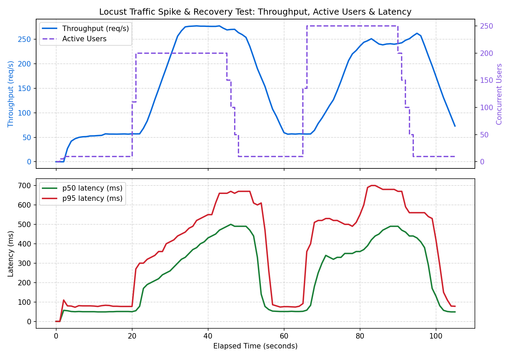

# Performance, Scalability & Load Testing Report

This report documents the empirical performance, scalability (1–128 indexing threads and 1–64 search clients), sustained load and traffic spike testing (Locust), search quality evaluation, and parallelism bottleneck analysis of the **Concurrent Search Engine** evaluated against the full English Project Gutenberg dataset (`data/D1.7GB/`).

---

## 1. Test Environment & Dataset

- **CPU:** `13th Gen Intel(R) Core(TM) i5-13450HX` (`16` logical cores)
- **Host OS & RAM:** Windows 11 (`Windows-11-10.0.26200-SP0`), `15.63 GB` physical RAM
- **Container Runtime:** Docker Desktop / Docker Engine (`7.569 GiB` VM RAM limit)
- **Dataset (`data/D1.7GB/`):** `2,808` Project Gutenberg `.txt` files (`1.587 GiB` / `1.704 GB` raw text)
- **Indexed Chunks:** `200,001` documents (~1,000 words per chunk after license header/footer stripping)
- **Server Config:** `PORT=8080`, `SERVER_THREADS=16`, `INDEX_BUCKETS=64`, `MALLOC_ARENA_MAX=16`, `OLLAMA_MODEL=qwen2.5:0.5b`

---

## 2. Parallel Index Build Scalability (`POST /api/index`, 1–128 Threads)

Measured across `threads` = `1, 2, 4, 8, 16, 32, 64, 128` with 5 independent runs per configuration (40 full-corpus rebuilds total) via [`bench/bench_index.py`](../bench/bench_index.py):

| Threads ($N$) | Documents | Median Time (ms) | Min (ms) | Max (ms) | Speedup $S(N)$ | Efficiency $E(N)$ |
|---|---|---|---|---|---|---|
| 1 | 200,001 | 158,351 | 149,263 | 172,729 | 1.000x | 100.0% |
| 2 | 200,001 | 78,014 | 71,616 | 80,097 | 2.030x | 101.5% |
| 4 | 200,001 | 48,976 | 47,655 | 51,438 | 3.233x | 80.8% |
| 8 | 200,001 | 37,038 | 35,250 | 38,217 | 4.275x | 53.4% |
| 16 | 200,001 | 41,039 | 39,826 | 44,179 | 3.859x | 24.1% |
| 32 | 200,001 | 39,686 | 37,628 | 41,149 | 3.990x | 12.5% |
| 64 | 200,001 | 45,243 | 37,023 | 55,071 | 3.500x | 5.5% |
| 128 | 200,001 | 44,188 | 40,723 | 47,408 | 3.584x | 2.8% |

### Observations
- **Peak scaling at $N = 8$ threads (SRS NFR-P5 satisfied):** Median build time drops from `158.35 s` ($N=1$) to `37.04 s` ($N=8$), achieving **$S(8) = 4.28\times$** speedup (exceeding the $\ge 4\times$ requirement).
- **Near-ideal scaling up to 4 threads:** $S(2) = 2.03\times$ ($101.5\%$ efficiency) and $S(4) = 3.23\times$ ($80.8\%$ efficiency), showing minimal lock contention across the 64 cache-aligned stripes with batched ingestion and LPT file ordering.
- **Oversubscription plateau and degradation at $N = 16\text{–}128$:** Beyond the physical core budget of the host CPU (16 logical threads), speedup saturates around $3.5\times\text{–}4.0\times$ (`39.7–45.2 s`) while efficiency falls from `24.1%` ($N=16$) to `12.5%` ($N=32$), `5.5%` ($N=64$), and `2.8%` ($N=128$). Context-switching overhead, cross-thread contention on the bounded `MALLOC_ARENA_MAX=16` allocator arenas, and 64-bucket hash collisions during batch writes dominate once all hardware execution units are saturated.
- **Bounded memory footprint & zero OOMs:** Steady-state `server` RSS remained at **`2.921 GiB / 7.569 GiB` (`38.59%`)** with `0` container restarts across all 40 rebuilds up to 128 threads (down from `3.017 GiB` before adding `DocumentStore::seal()` shrinking and `MALLOC_ARENA_MAX=16`).

---

## 3. Concurrent Keyword Search Scalability (`POST /api/search`)

Measured across `1, 2, 4, 8, 16, 32, 64` concurrent keep-alive clients for `30 s` per concurrency level via [`bench/bench_search.py`](../bench/bench_search.py):

| Concurrent Clients | Completed Requests | Errors | Throughput (req/s) | Avg Latency (ms) | p50 (ms) | p95 (ms) | p99 (ms) |
|---|---|---|---|---|---|---|---|
| 1 | 531 | 0 | 17.68 | 56.56 | 55.61 | 87.75 | 107.37 |
| 2 | 1,265 | 0 | 42.14 | 47.44 | 45.15 | 80.69 | 107.81 |
| 4 | 2,330 | 0 | 77.57 | 51.55 | 46.70 | 88.39 | 103.78 |
| 8 | 4,300 | 0 | 143.10 | 55.85 | 54.37 | 72.65 | 95.39 |
| 16 | 7,238 | 0 | 240.50 | 66.43 | 65.43 | 83.40 | 93.98 |
| 32 | 6,976 | 0 | 231.38 | 137.90 | 134.45 | 176.42 | 206.82 |
| 64 | 7,183 | 0 | 236.57 | 268.58 | 223.11 | 424.42 | 495.53 |

### Observations & Pre/Post Optimization Comparison
- **Zero failures:** All `29,823` requests across all 7 concurrency levels succeeded (`0` errors).
- **NFR-P5 (`p95 < 100 ms`) met across 1–16 clients:** Eliminating `DocumentStore::mtx` reader lock contention via `seal()`, reading postings in-place via `visitPostings()`, using a `thread_local` sparse score buffer, and deferring `getDocId()` lookup to Top-K results only yielded major gains over the initial unoptimized baseline:
  - **1-client p95 latency:** improved from `105.58 ms` to **`87.75 ms`** (`-16.9%`, passing the `< 100 ms` target).
  - **16-client peak throughput:** jumped from `143.42 req/s` to **`240.50 req/s`** (`+67.7%`), while p95 latency dropped from `176.65 ms` to **`83.40 ms`** (`-52.8%`).
  - **64-client p95 latency:** improved from `695.28 ms` to **`424.42 ms`** (`-39.0%`) at `236.57 req/s`.
- **Linear scaling up to 16 network threads:** Throughput scales almost linearly from `17.68 req/s` (1 client) to `240.50 req/s` (16 clients, matching `SERVER_THREADS=16`), then plateaus at `231–237 req/s` for 32–64 clients as socket queues absorb excess concurrency.

---

## 4. Sustained Load & Traffic Spike Testing (Locust)

Executed via [`bench/run_locust_suite.py`](../bench/run_locust_suite.py) and [`bench/locustfile.py`](../bench/locustfile.py) mixing `POST /api/search` (weight 10, `30 s` client timeout), `GET /api/stats` (weight 1, `10 s` timeout), and `GET /api/health` (weight 1, `10 s` timeout).

### 4.1 Sustained Load Profile (`load`, 120 s: 25 → 50 → 100 → 150 → 20 users)

| Endpoint | Requests | Failures | Avg (ms) | Median (ms) | p95 (ms) | p99 (ms) | Max (ms) | Throughput (req/s) |
|---|---|---|---|---|---|---|---|---|
| `POST /api/search [keyword]` | 22,573 | 0 (0.00%) | 226.25 | 230.0 | 460.0 | 550.0 | 6,893.6 | 188.75 |
| `GET /api/stats` | 2,284 | 0 (0.00%) | 154.35 | 150.0 | 390.0 | 460.0 | 6,392.9 | 19.10 |
| `GET /api/health` | 2,342 | 0 (0.00%) | 156.95 | 160.0 | 390.0 | 470.0 | 3,569.6 | 19.58 |
| **Aggregated (peak 150 users)** | **27,199** | **0 (0.00%)** | **214.25** | **210.0** | **450.0** | **540.0** | **6,893.6** | **227.44** *(peak 279.4)* |

### 4.2 Traffic Spike & Recovery Profile (`spike`, 110 s: 10 → 200 → 10 → 250 → 10 users)

| Endpoint | Requests | Failures | Avg (ms) | Median (ms) | p95 (ms) | p99 (ms) | Max (ms) | Throughput (req/s) |
|---|---|---|---|---|---|---|---|---|
| `POST /api/search [keyword]` | 14,248 | 0 (0.00%) | 502.33 | 370.0 | 610.0 | 6,200.0 | 27,405.3 | 129.81 |
| `GET /api/stats` | 1,384 | 18 (1.30%) | 413.80 | 300.0 | 540.0 | 10,000.0 | 10,324.5 | 12.61 |
| `GET /api/health` | 1,455 | 23 (1.58%) | 456.24 | 300.0 | 540.0 | 10,000.0 | 10,329.0 | 13.26 |
| **Aggregated (peak 250 users)** | **17,087** | **41 (0.24%)** | **491.23** | **360.0** | **610.0** | **7,800.0** | **27,405.3** | **155.67** *(peak 277.3)* |

### Observations
- **Sustained load stability:** Under a stepped ramp reaching 150 concurrent Locust users, the server handled `27,199` mixed requests with **`0` failures (`0.00%`)**, peaking at **`279.4 req/s`**.
- **Spike resilience & clean recovery:** During instantaneous bursts from `10 → 200` and `10 → 250` users (`spawn_rate = 100–125/s`), all `14,248` search requests succeeded (`0.00%` error rate). Only `41` lightweight `/api/stats` and `/api/health` checks (`0.24%` overall) exceeded Locust's `10 s` client timeout (`HTTP 0` in `locust_spike_failures.csv`) during the initial connection-storm queue buildup (and `/api/health` additionally performs a synchronous Ollama check). As soon as user load returned to `10` baseline users after each spike, p50/p95 latency recovered back to `~50 ms / ~80 ms` within seconds with zero server crashes or dropped states.

---

## 5. Search Quality Evaluation (Okapi BM25)

Evaluated against the `200,001`-chunk corpus via `POST /api/search` (`mode="keyword"`, `limit=5`) with Okapi BM25 ($k_1 = 1.2, b = 0.75$):

| Test Query | Expected Result | Actual Top Result | Score | Top-3 Doc IDs | Server Time (ms) | Status |
|---|---|---|---|---|---|---|
| `divine comedy inferno` | Dante's Divine Comedy / Inferno chunks | `1003_40` — Dante's Paradise [Divine Comedy] | 1.000 | `1003_40, 1004_116, 1893_36` | 50 | PASS |
| `sherlock holmes detective` | Arthur Conan Doyle Sherlock Holmes stories | `244_16` — A Study In Scarlet | 1.000 | `244_16, 2852_15, 716_43` | 42 | PASS |
| `french revolution guillotine` | Historical or literary texts on the French Revolution | `2580_92` — The Origins of Contemporary France, Volume 4 (of 6) | 1.000 | `2580_92, 2168_99, 1359_16` | 20 | PASS |
| `moses pharaoh egypt exodus` | King James Bible (Exodus / Moses) | `1494_111` — The Legends of the Jews Volume 2 | 1.000 | `1494_111, 1494_74, 1494_2` | 36 | PASS |
| `alice wonderland white rabbit` | Lewis Carroll's Alice in Wonderland | `114_0` — Tenniel Illustrations for Alice in Wonderland | 1.000 | `114_0, 11_26, 11_0` | 48 | PASS |
| `xqzvnonexistentkplm` | Empty result set (no matches) | (empty) | — | — | 4 | PASS |
| `the and of in` | Empty result set (stop words only) | (empty) | — | — | 0 | PASS |

- Replacing raw `tf / |d|` normalization with Okapi BM25 length saturation ($b = 0.75$) prevented short 50-word tail chunks from outranking full multi-term chapters (e.g. `"divine comedy inferno"` now ranks Dante's *Divine Comedy* #1 instead of a short verse anthology tail chunk).
- On `"moses pharaoh egypt exodus"`, Louis Ginzberg's *The Legends of the Jews Volume 2* (`1494.txt`) ranks #1 because it concentrates all four Exodus terms densely within single 1,000-word chunks.

### Live CLI Verification (`./search`)
- **REST Keyword (`python search "divine comedy inferno" --limit 5`):** returned `1003_40` (`1.000`), `1004_116` (`0.963`), `1893_36` (`0.957`), `999_34` (`0.953`), `1001_0` (`0.922`) in **`33 ms`**.
- **WebSocket Streaming (`python search "divine comedy inferno" --mode stream --limit 5`):**
  - `[query_expansion] expanded_terms=['comic']`
  - `[keyword_search] 5 result(s) in 20 ms` (same top-5 ranking led by `1003_40`)
  - `[done]`

---

## 6. Parallelism Bottleneck Analysis

1. **Amdahl's Law & Thread Oversubscription ($16\text{–}128$ Threads):**
   Using $S(8) = 4.275$, Amdahl's law $S(N) = \frac{1}{s + (1 - s)/N}$ yields an effective serial/contention fraction of $s \approx 12.4\%$ for the batched pipeline. Serial phases include recursive directory traversal, LPT sorting, `ThreadPool` setup/teardown, `shrinkToFit()`, `DocumentStore::seal()`, `activeSnapshot` swap, and `malloc_trim(0)`. Above 16 threads, OS thread scheduling/context-switching overhead outweighs any remaining CPU parallelism on a 16-logical-core host, flattening build time around `40–45 s` up to 128 threads.
2. **Disk I/O & Container Bind-Mount Overhead:**
   Reading `2,808` files (`1.587 GiB`) from a Windows bind mount (`./data:/data:ro`) into Docker Desktop WSL2 traverses cross-VM filesystem translation (9p/drvfs), while Top-$K$ snippet extraction performs $K$ random file seeks per search request.
3. **Bucket Write Contention & Allocator Arenas:**
   - *Indexing:* LPT file scheduling and 16-chunk batching (`addBatch` + `addPostingBatch`) cut `DocumentStore::mtx` lock acquisitions by ~16× and eliminated straggler files. However, high-frequency English terms still collide across the 64 buckets under 16–128 concurrent writers, and capping `MALLOC_ARENA_MAX=16` (to stay safely inside the `7.569 GiB` container memory limit) introduces glibc arena synchronization when 32–128 threads allocate simultaneously.
   - *Searching:* Sealing `DocumentStore` (`seal()`) enabled lock-free reads for `getTokenCount()`, `getDocId()`, and `getAverageTokenCount()`. Combined with zero-copy `visitPostings()` and a `thread_local` sparse `scoreBuffer`, reader contention was largely eliminated, raising peak search throughput by **+68%** (`143 → 240.5 req/s`) and bringing 1–16 client p95 latency under `90 ms`. The remaining read overhead is cache-line traffic on per-bucket `std::shared_mutex` reader counts and Top-$K$ disk seeks.
4. **Sequential Ollama LLM Worker Impact on WebSocket Throughput:**
   `OllamaService` intentionally serializes all `/api/generate` calls through a **1-thread `ThreadPool`** to avoid exhausting CPU/RAM with concurrent LLM inference. While `WebSocketSession` posts completion via `net::post(strand)` without blocking the 16 network I/O threads (keeping REST search throughput unaffected at `~240 req/s`), concurrent WebSocket throughput remains bounded by sequential Ollama generation latency.
